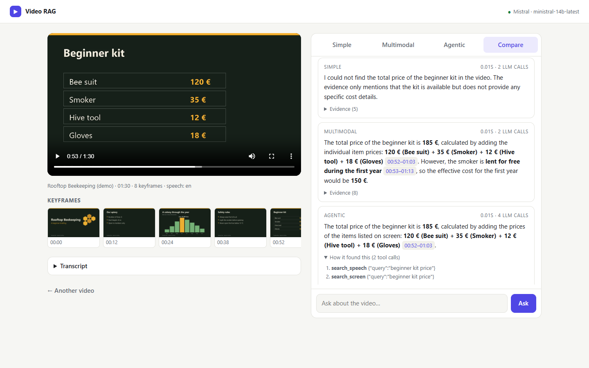

# Video RAG

**[Try the demo →](https://assim-ben-ahmed.github.io/video-rag/)** (recorded answers on the demo video; run it locally to use your own videos)

Ask questions about a video and get answers that point to the exact moment. Speech is transcribed locally with
Whisper, every visual change becomes a described keyframe, and three answering strategies can be compared side by
side, each citing clickable timestamps.



## Why

A transcript-only RAG is blind to everything that is **shown but not said**: a price on a slide, a chart value, the
colour of an object. This project measures that gap on a video built for the purpose, and compares two ways of
closing it.

| Mode | How it answers |
|---|---|
| **Simple** | Hybrid search over the transcript only, then one answer. The classic text-RAG baseline. |
| **Multimodal** | One hybrid search over speech **and** keyframe descriptions, then one answer. |
| **Agentic** | Tool-calling loop (max 5 steps): `search_speech`, `search_screen`, and `look_at_frame(mm:ss, question)` to inspect a moment up close. Shows its trace. |

## Results on the demo video

`demo/rooftop-bees.mp4` is a 90-second narrated briefing generated by `scripts/make_demo_video.py` (8 slides,
offline text-to-speech). Its 19 questions are split on purpose: **8 answered only by the narration, 8 only by what is
on screen, 3 that need both** (for example adding up prices from a table).

| Mode | Spoken only | Shown only | Both | **All 19** | Cited the right moment | LLM calls / question | Median latency |
|---|---|---|---|---|---|---|---|
| Simple | 100% | 0% | 0% | **42%** | 63% | 2.0 | 0.8 s |
| Multimodal | 100% | 100% | 100% | **100%** | 100% | 2.0 | 0.8 s |
| Agentic | 100% | 100% | 100% | **100%** | 100% | 4.4 | 1.8 s |

Models: `ministral-14b-latest` (chat and vision), `mistral-embed`, Whisper `small` on CPU. Ingesting the 90 s video
takes about 40 s. Every answer is in [`reports/eval.md`](reports/eval.md); raw data in `reports/metrics.json`.

**Reading it honestly**

- The transcript-only baseline answers every spoken question and **none** of the visual ones: on this video, a
  text RAG misses more than half the content.
- On clean slides, describing keyframes at ingest time (multimodal) is enough: the agent is as accurate but costs
  ~2× the calls and latency. Its extra steps should pay off when descriptions are vague (busy scenes, small text),
  which this demo does not test.
- 19 questions on one synthetic video is a sanity check, not a benchmark. Expected answers are checked by keyword, so
  a correct answer phrased unusually could be counted wrong.

**What the evaluation caught during development** (first run: 84% / 79% for multimodal / agentic)

1. The keyframe detector missed a slide: from one dark text slide to another, the *average* pixel difference barely
   moved. It now counts the share of pixels that change, which also catches a single new line of text (covered by a
   test), with a minimum gap and a cap so moving footage does not trigger a vision call every second.
2. The agent sometimes called `look_at_frame` at a guessed time, or searched only the speech. Its instructions now
   say: search speech and screen together first, inspect frames only at timestamps a search returned, and check
   every part of a multi-part question.
3. Whisper `base` heard "2000 *ex* a day", "beginner *kid*" and "*buck fast*". `small` fixed all three.

## Run it

Requires Python 3.10+ and a [Mistral API key](https://console.mistral.ai). ffmpeg ships with the `imageio-ffmpeg`
package, nothing else to install.

```bash
python -m venv .venv && .venv\Scripts\activate      # macOS/Linux: source .venv/bin/activate
pip install -r requirements-dev.txt                 # runtime + demo generator + tests
copy .env.example .env                                # macOS/Linux: cp; then add MISTRAL_API_KEY
uvicorn videorag.app:app --port 8000
```

Open http://localhost:8000, then **Try the demo video** or upload your own (MP4, MOV, MKV, WebM, up to 500 MB). The
first run downloads the Whisper model (~460 MB for `small`; set `WHISPER_MODEL=base` for a faster, less accurate one).

```bash
python scripts/make_demo_video.py   # regenerate the demo video and its questions (Windows voice via pyttsx3)
python scripts/evaluate.py          # run the 19 questions in every mode -> reports/
python scripts/build_static_demo.py # refresh the GitHub Pages demo in docs/
pytest                              # 21 offline tests, no key or network needed
```

Or with Docker: `docker build -t video-rag . && docker run -p 7860:7860 --env-file .env video-rag`, then open
http://localhost:7860.

## Demo page

[`docs/`](docs/) is a static page served by GitHub Pages: the demo video, its keyframes and transcript, and the 57
answers (19 questions × 3 modes) recorded from the real pipeline, with their evidence and agent traces. Rebuild it
with `python scripts/build_static_demo.py` (free after `evaluate.py`, every response comes from the cache).

## Deploying the live app

The Docker image is ready for a public host (it listens on port 7860). With `PUBLIC_MODE=1` (set in the Dockerfile),
uploads are limited to 3 minutes and 100 MB, one video is processed at a time and each visitor can ask 40 questions
per hour, so a public link cannot drain the API quota. The demo video ships with its index prebuilt and opens
instantly; the Whisper model is downloaded at build time. Pass `MISTRAL_API_KEY` as a secret, never in the image.

## How it works

```
video ─┬─ ffmpeg → 16 kHz audio → faster-whisper (local) → segments → ~15 s chunks (1-segment overlap)
       └─ OpenCV: sample 1 frame/s → new keyframe when >1.5% of pixels change → vision model describes it
                                     (all visible text, numbers, chart values, colours)
           ↓
   docs (speech | screen, start, end, text) → mistral-embed + BM25 → reciprocal rank fusion
           ↓
   simple / multimodal: top-k evidence → one answer with [mm:ss] citations
   agentic: tool loop → search_speech · search_screen · look_at_frame → answer + trace
```

- **Hybrid retrieval:** embeddings find paraphrases, BM25 finds exact tokens such as "24 m" or "Buckfast"; the two
  rankings are merged with reciprocal rank fusion.
- **Grounding:** the model may only use the evidence it is given, must cite timestamps, and must say when the video
  does not contain the answer.
- **Cost control:** every API response is cached on disk by request hash, so re-opening a video or re-running the
  evaluation is free; 429 rate limits are retried with backoff.
- **Privacy:** speech-to-text runs locally. Keyframe images and text are sent to the Mistral API.

## Project layout

```
videorag/       config, llm (Mistral client, cache, retries), media (audio, keyframes), transcribe,
                index (hybrid search), ingest (pipeline), answer (3 modes, agent tools), app (FastAPI)
web/            the interface (plain HTML/CSS/JS, no build step)
scripts/        make_demo_video.py, evaluate.py
demo/           the generated demo video, its timeline and the 19 questions
reports/        evaluation results
docs/           the static demo page (GitHub Pages) and screenshots
tests/          offline tests (fake embedder, scripted LLM, generated test video)
```

## Limits

- Long videos are processed sequentially on CPU; a 30-minute video means several minutes of Whisper and up to 80
  vision calls.
- Keyframe detection is tuned for slides and screen recordings; for fast-moving footage it falls back to the time
  gap and the 80-frame cap, so brief moments can be missed.
- Index and uploads live on local disk (`data/`), one process; this is a demo app, not a multi-user service.

---

Built by [Assim Ben Ahmed](https://assim-ben-ahmed.github.io/portfolio/). A personal project, written from scratch,
on a topic I first explored during an AI Clinic mission at aivancity (2025–26); it contains no code or data from that
mission.
